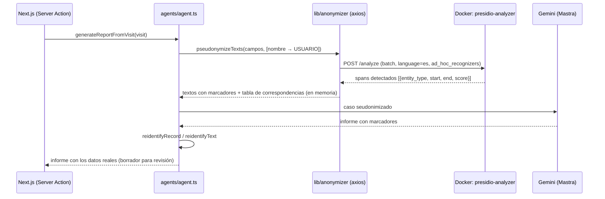
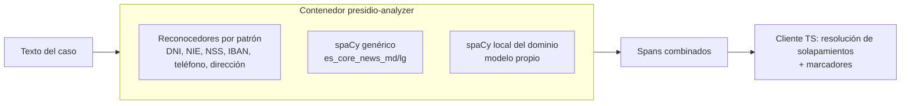

# Anonimización de datos personales

Los casos de servicios sociales contienen datos personales y, a menudo, datos de categoría especial (salud, violencia, menores). Antes de enviar un caso al modelo de lenguaje (Gemini, vía Mastra), la app sustituye esos datos por marcadores. Cuando el informe vuelve, restaura los datos originales.

- **Fase 1 (implementada):** Presidio Analyzer en Docker, con el modelo spaCy en español genérico y reconocedores por patrones. La app lo consulta con un cliente HTTP (axios).
- **Fase 2 (futura):** enfoque híbrido, con Presidio y un modelo spaCy local entrenado con datos del dominio.

---

## 1. Arquitectura



Decisiones de diseño:

| Decisión | Motivo |
|---|---|
| Se usa la **imagen oficial** `mcr.microsoft.com/presidio-analyzer`, configurada solo con YAML | No hay código Python propio que mantener. Actualizar Presidio consiste en cambiar el tag de la imagen. |
| Presidio **solo detecta** (`/analyze`). La sustitución se hace en TypeScript | `presidio-anonymizer` aplica un operador por tipo de entidad, así que no puede asignar `[PERSONA_1]` y `[PERSONA_2]` de forma estable entre campos ni devolver la tabla que necesitamos para reidentificar. Por eso no se despliega ese contenedor. |
| **Seudonimización reversible** con marcadores legibles (`[PERSONA_1]`) | El LLM sigue entendiendo quién es quién, y el informe final lleva los nombres reales. |
| **Fallo cerrado** | Si Presidio no responde, no se genera el informe y no se envía ningún dato al LLM. |
| La tabla de correspondencias **solo vive en memoria** | Contiene los datos reales. No se persiste ni se registra en logs. |
| No se anonimizan `LOCATION` ni `ORGANIZATION` | El agente necesita el municipio y las instituciones para buscar la normativa y los recursos. Las direcciones postales sí se anonimizan (`ES_ADDRESS`). |

## 2. Componentes

| Ruta | Qué es |
|---|---|
| [docker-compose.yml](docker-compose.yml) | Servicio `presidio-analyzer`, publicado solo en `127.0.0.1:5002`. |
| [presidio/Dockerfile](presidio/Dockerfile) | Parte de la imagen oficial `presidio-analyzer:2.2.362` y le añade el modelo spaCy `es_core_news_md` y la configuración. |
| [presidio/conf/nlp.yaml](presidio/conf/nlp.yaml) | Motor NLP (spaCy en español) y correspondencia de etiquetas NER (`PER`→`PERSON`, etc.). |
| [presidio/conf/analyzer.yaml](presidio/conf/analyzer.yaml) | Idioma `es` y umbral de puntuación por defecto (0.4). |
| [presidio/conf/recognizers.yaml](presidio/conf/recognizers.yaml) | Reconocedores activos: predefinidos y patrones propios para España. |
| [app/src/lib/anonymizer/presidioClient.ts](app/src/lib/anonymizer/presidioClient.ts) | Cliente axios: `analyzeTexts()`, con timeout, reintentos con backoff ante errores de red o 5xx, y validación de la respuesta con Zod. |
| [app/src/lib/anonymizer/pseudonymizer.ts](app/src/lib/anonymizer/pseudonymizer.ts) | `pseudonymizeTexts()`, resolución de solapamientos, tabla de marcadores, `reidentifyText()` y `reidentifyRecord()`. |
| [app/src/agents/agent.ts](app/src/agents/agent.ts) | Integración: seudonimiza la visita, llama al LLM y reidentifica el informe. |
| [app/scripts/debugAnonymizer.ts](app/scripts/debugAnonymizer.ts) | Prueba manual contra el contenedor, sin llamar al LLM. |

## 3. Puesta en marcha

```bash
# Desde la raíz del repositorio. El primer build descarga la imagen y el modelo (~1-2 min).
docker compose up -d --build presidio-analyzer

# Comprobaciones
curl localhost:5002/health                         # "Presidio Analyzer service is up"
curl "localhost:5002/recognizers?language=es"      # lista de reconocedores cargados

# Prueba de seudonimización (sin LLM)
cd app && npx tsx scripts/debugAnonymizer.ts
```

En VS Code también existe la configuración de depuración **"Depurar anonimización (Presidio)"**.

### Variables de entorno (`app/.env.local`)

| Variable | Valor por defecto | Descripción |
|---|---|---|
| `PRESIDIO_ANALYZER_URL` | `http://localhost:5002` | URL del contenedor. En un despliegue con Compose, usar el nombre del servicio (`http://presidio-analyzer:3000`). |
| `ANONYMIZATION_DISABLED` | *(sin definir)* | Con `true` se omite la anonimización y se registra un aviso. **Solo para desarrollo local con datos ficticios.** No debe definirse nunca en producción. |

## 4. Qué se detecta

| Entidad | Marcador | Cómo se detecta |
|---|---|---|
| Nombre de la persona usuaria (`visit.clientName`) | `[USUARIO]` | Reconocedor *ad hoc* de lista (`deny_list`) enviado en cada petición. Si el NER detecta una parte del nombre ("Carmen"), también se asigna a `[USUARIO]`. |
| `PERSON` | `[PERSONA_n]` | NER de spaCy (`es_core_news_md`) |
| `ES_NIF` / `ES_NIE` | `[DNI_n]` / `[NIE_n]` | Predefinidos de Presidio, con validación de la letra de control |
| `ES_NSS` | `[NSS_n]` | Patrón propio y contexto ("seguridad social", "NAF"…) |
| `ES_HEALTH_CARD` | `[TARJETA_SANITARIA_n]` | Patrón propio (CIP autonómico) y contexto |
| `ES_ADDRESS` | `[DIRECCION_n]` | Patrón propio: tipo de vía, nombre y número ("Calle Feria 23, 2º B") |
| `PHONE_NUMBER` | `[TELEFONO_n]` | Patrón propio para fijos y móviles españoles, con o sin +34 |
| `EMAIL_ADDRESS`, `IBAN_CODE`, `CREDIT_CARD` | `[EMAIL_n]`, `[IBAN_n]`, `[TARJETA_n]` | Predefinidos de Presidio, con contexto en español |

Reglas de la sustitución:

- **Mismo valor, mismo marcador** en todos los campos de la visita. `Javier Martínez López` es `[PERSONA_1]` tanto en las notas como en la historia de vida.
- **Solapamientos:** se queda el span con mayor puntuación y, si empatan, el más largo. Así, un email gana al nombre que contiene, y `[USUARIO]` (puntuación 1.0) gana a `PERSON` (0.85).
- Las instrucciones del agente ([instructions.ts](app/src/agents/instructions.ts)) le piden que use los marcadores tal cual y que no los incluya nunca en búsquedas.

Ejemplo (salida de `debugAnonymizer.ts`):

```text
Entrada: Carmen Ruiz Delgado (DNI 12345678Z) acude acompañada de su sobrino Javier Martínez López…
         Vive sola en Calle Feria 23, 2º B, de Sevilla.
Salida:  [USUARIO] (DNI [DNI_1]) acude acompañada de su sobrino [PERSONA_1]…
         Vive sola en [DIRECCION_1], de Sevilla.
```

### Cambiar la configuración

- **Añadir o ajustar un reconocedor:** editar `presidio/conf/recognizers.yaml` y ejecutar `docker compose up -d --build`. Los reconocedores `type: custom` admiten `patterns`, `deny_list` y `context`.
- **Anonimizar más o menos entidades:** cambiar `DEFAULT_ENTITIES` en `pseudonymizer.ts`. Si se añade un tipo nuevo, darle un marcador legible en `PLACEHOLDER_LABELS`.
- **Modelo más preciso:** cambiar a `es_core_news_lg` (~550 MB) en `presidio/Dockerfile` (`ARG SPACY_MODEL`) y en `presidio/conf/nlp.yaml`.

## 5. Seguridad y limitaciones

- El puerto del contenedor solo se publica en `127.0.0.1`. En producción, el contenedor debe estar en una red privada, sin exposición pública, porque recibe texto en claro.
- El cliente solo registra el estado HTTP y el número de intentos. Nunca registra textos ni la tabla de correspondencias.
- **La detección no es perfecta.** El NER genérico puede no detectar nombres poco frecuentes, apodos o nombres en minúscula, y puede marcar como persona palabras que no lo son. La seudonimización **reduce** el riesgo, pero no sustituye a la revisión humana ni a la base jurídica del tratamiento (RGPD/LOPDGDD), que sigue siendo necesaria.
- Quedan sin anonimizar, por diseño, el municipio, los centros e instituciones, las edades, las fechas y las cuantías. Combinados, pueden permitir reidentificar a alguien en municipios pequeños. Hay que tenerlo en cuenta en la evaluación de impacto (EIPD).
- Si el LLM altera un marcador (por ejemplo, escribe `PERSONA_1` sin corchetes), ese marcador no se restaura y aparece tal cual en el borrador. Como el informe siempre pasa por revisión profesional, el fallo es visible y no hay fuga de datos.

## 6. Fase 2: enfoque híbrido (Presidio + modelo spaCy local)

**Objetivo:** mejorar la cobertura en el lenguaje propio de los servicios sociales, que el modelo genérico (entrenado con noticias) reconoce mal. Por ejemplo: nombres en notas de campo informales, parentescos con nombre ("su hija Lucía"), nombres de centros educativos o sanitarios concretos y apodos. Se mantienen los reconocedores deterministas de Presidio para identificadores y contacto.

### Diseño



1. **Entrenar el modelo local**
   - Corpus: notas de visitas **sintéticas o previamente anonimizadas a mano**. Nunca datos reales sin una base legal y una EIPD.
   - Anotación con Prodigy, Label Studio o doccano, con las etiquetas `PER`, `LOC`, `ORG` y las que se definan (`CENTRO`, `APODO`…).
   - Ajuste fino de `es_core_news_lg` (o de un pipeline `spacy-transformers` sobre un modelo en español, como RoBERTa-BNE) con `spacy train`.
   - Empaquetado con `spacy package` como un wheel versionado, por ejemplo `es_social_ner-1.0.0`.
2. **Integrarlo en el contenedor, sin código propio**
   - `presidio/Dockerfile`: instalar el wheel (`COPY models/es_social_ner-*.whl` + `pip install`).
   - `presidio/conf/nlp.yaml`: usar el modelo local como motor NLP de `es` y mapear sus etiquetas nuevas en `model_to_presidio_entity_mapping`.
   - Para conservar a la vez el modelo genérico (el híbrido "doble NER"), se puede añadir el modelo genérico como segundo reconocedor NER en `recognizers.yaml`. Si la configuración YAML no bastara, se publicaría una imagen derivada con un `EntityRecognizer` propio. Esta es la única situación en la que haría falta código Python, y quedaría encapsulado en la imagen.
3. **Cambios en la app:** ninguno en el cliente, salvo añadir las entidades nuevas a `DEFAULT_ENTITIES` y `PLACEHOLDER_LABELS`. El contrato `POST /analyze` no cambia.
4. **Evaluación antes de activarlo**
   - Conjunto de prueba anotado y separado del de entrenamiento.
   - Métricas por entidad, con prioridad en el **recall** (un dato no detectado es una fuga; un falso positivo solo empeora un poco el informe). Objetivo orientativo: recall ≥ 0.95 en `PERSON`.
   - Comparar Fase 1 y Fase 2 sobre el mismo conjunto. Ajustar `default_score_threshold` y `low_confidence_score_multiplier`.
5. **Despliegue:** etiquetar la imagen con la versión del modelo (`social-copilot/presidio-analyzer:2.2.362-es-social-1.0.0`) para poder volver a la anterior.

### Tareas pendientes

- [ ] Definir el esquema de etiquetas del dominio.
- [ ] Generar un corpus sintético y anotarlo.
- [ ] Entrenar y evaluar frente al modelo genérico.
- [ ] Empaquetar el modelo e integrarlo en `presidio/`.
- [ ] Tests automáticos de regresión del cliente (`pseudonymizer.ts`) con resultados de Presidio simulados.
